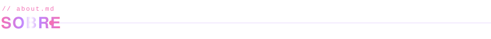
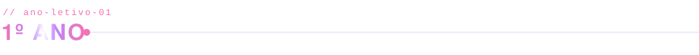
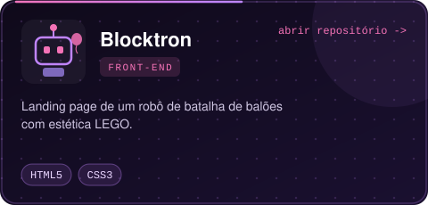
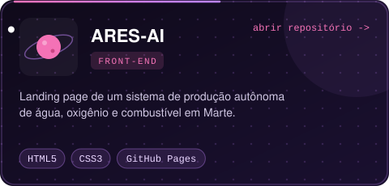
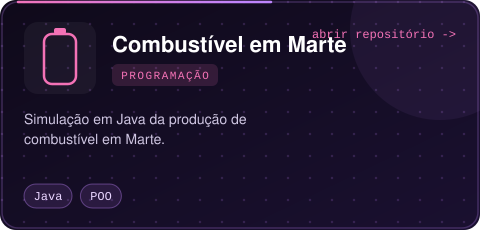
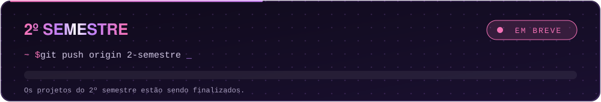

  

  
  
  

Este é o meu repositório de acompanhamento acadêmico. Ele documenta minha evolução, meus projetos e as entregas que fiz ao longo da graduação em **Sistemas de Informação na FIAP**.

O conteúdo segue a ordem cronológica, por **ano letivo** e **semestre**. Cada período reúne as disciplinas cursadas e os projetos desenvolvidos nelas.

Meus projetos pessoais estão no meu perfil: [@AnaBia-Kurihara](https://github.com/AnaBia-Kurihara).

  

No primeiro ano, o foco foi construir a base da formação: lógica de programação, orientação a objetos e fundamentos de desenvolvimento web e design de interfaces.

<b>1º Semestre</b> &nbsp;·&nbsp; Front-end e Programação <i>(clique para abrir ou fechar)</i>

 

No primeiro semestre, os projetos ficaram em duas frentes:

- **Front-end:** criação de landing pages responsivas com HTML5 e CSS3, com atenção à identidade visual, à hierarquia da informação e à experiência do usuário.
- **Programação:** desenvolvimento de sistemas em Java a partir de problemas reais, aplicando lógica de programação e os primeiros conceitos de orientação a objetos.

  
  

  

  

<b>2º Semestre</b> &nbsp;·&nbsp; em breve

 

 

